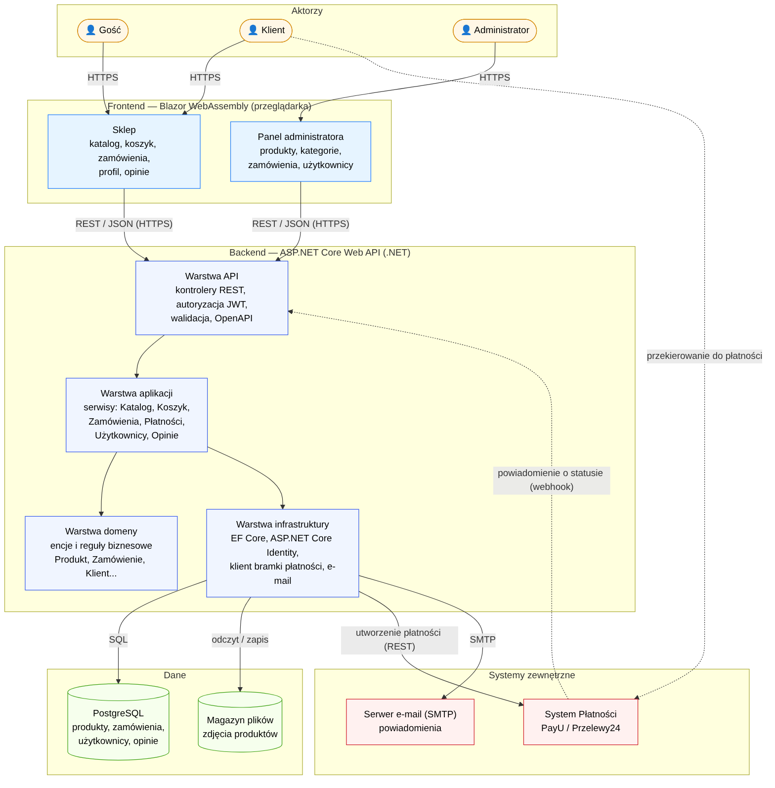

# Architektura systemu – Sklep Internetowy

Plik źródłowy diagramu: [`architektura.mmd`](architektura.mmd) (Mermaid).

## Opis

System jest zbudowany w architekturze **klient–serwer** z podziałem backendu na warstwy
(tzw. *Clean Architecture*). Całość to jedna aplikacja backendowa (monolit modułowy).
Przy skali sklepu internetowego tworzonego przez mały zespół jest to prostsze w budowie,
testowaniu i wdrażaniu niż mikroserwisy.

### Elementy systemu

| Element | Odpowiedzialność |
|---|---|
| **Frontend – Sklep** | Interfejs dla Gościa i Klienta: przeglądanie katalogu, koszyk, składanie zamówień, profil, historia zamówień, opinie. |
| **Frontend – Panel administratora** | Interfejs dla Administratora: zarządzanie produktami, kategoriami, zamówieniami i kontami użytkowników. Dostęp tylko dla roli *Administrator*. |
| **Warstwa API** | Udostępnia REST API (JSON), sprawdza uwierzytelnienie (JWT) i uprawnienia (role), waliduje dane wejściowe. Przyjmuje też powiadomienia (webhook) z bramki płatności. |
| **Warstwa aplikacji** | Logika przypadków użycia, np. „złóż zamówienie”, „dodaj do koszyka”, „zmień status zamówienia”. |
| **Warstwa domeny** | Encje (Produkt, Kategoria, Zamówienie, Klient, Opinia) i reguły biznesowe, np. nie można zamówić produktu, którego nie ma w magazynie. Nie zależy od żadnej innej warstwy. |
| **Warstwa infrastruktury** | Dostęp do bazy danych (EF Core), konta użytkowników (ASP.NET Core Identity), komunikacja z bramką płatności i serwerem e-mail, zapis zdjęć produktów. |
| **PostgreSQL** | Relacyjna baza danych: produkty, kategorie, zamówienia, użytkownicy, opinie. |
| **Magazyn plików** | Zdjęcia produktów (lokalny katalog lub chmura, np. Azure Blob Storage). |
| **System Płatności (zewnętrzny)** | Bramka PayU / Przelewy24 autoryzująca transakcje. |
| **Serwer e-mail (SMTP)** | Wysyłka powiadomień: potwierdzenie zamówienia, informacja o wysyłce. |

### Przepływ płatności (powiązanie z procesem biznesowym)

1. Klient wybiera dostawę i płatność, a backend tworzy zamówienie ze statusem *oczekuje na płatność*.
2. Backend wysyła żądanie utworzenia płatności do bramki (REST), a Klient zostaje przekierowany na stronę bramki.
3. Bramka wysyła do API powiadomienie o wyniku (webhook):
   - **sukces**: zamówienie dostaje status *opłacone* i trafia do Administratora do weryfikacji i pakowania,
   - **błąd**: system wyświetla błąd płatności, a Klient może spróbować ponownie (sytuacja wyjątkowa z diagramu procesu).
4. Po spakowaniu zamówienia przez Administratora system wysyła e-mail o wysyłce.

## Legenda

| Symbol | Znaczenie |
|---|---|
| Zaokrąglony prostokąt (pomarańczowy) | Aktor (użytkownik systemu) |
| Prostokąt (niebieski) | Komponent systemu (frontend / warstwa backendu) |
| Walec (zielony) | Magazyn danych |
| Prostokąt (czerwony) | System zewnętrzny |
| Ramka z tytułem | Grupa komponentów (np. Frontend, Backend) |
| Strzałka ciągła | Wywołanie / komunikacja inicjowana przez element źródłowy (podpis = protokół) |
| Strzałka przerywana | Komunikacja asynchroniczna lub przekierowanie (webhook, przekierowanie do płatności) |
