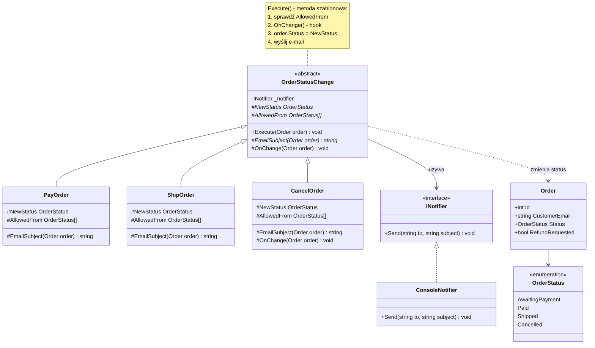

# Wzorzec projektowy: Template Method

Wzorzec z [katalogu refactoring.guru](https://refactoring.guru/pl/design-patterns/template-method).



Plik źródłowy diagramu: [`diagram-klas-template-method.mmd`](diagram-klas-template-method.mmd)

## Po co nam ten wzorzec

Zamówienie w sklepie zmienia status, np. z „Oczekuje na płatność” na „Opłacone”, potem „Wysłane”.
Za każdym razem robimy to samo:

1. sprawdzamy, czy taka zmiana jest dozwolona,
2. zmieniamy status,
3. wysyłamy klientowi e-mail.

Różni się tylko nowy status i treść e-maila. Zamiast pisać ten sam kod trzy razy,
zapisujemy go raz w klasie `OrderStatusChange` (metoda `Execute()`).
Klasy `PayOrder`, `ShipOrder` i `CancelOrder` podają tylko to, co jest u nich inne.

## Demo

```bash
dotnet run --project src
```